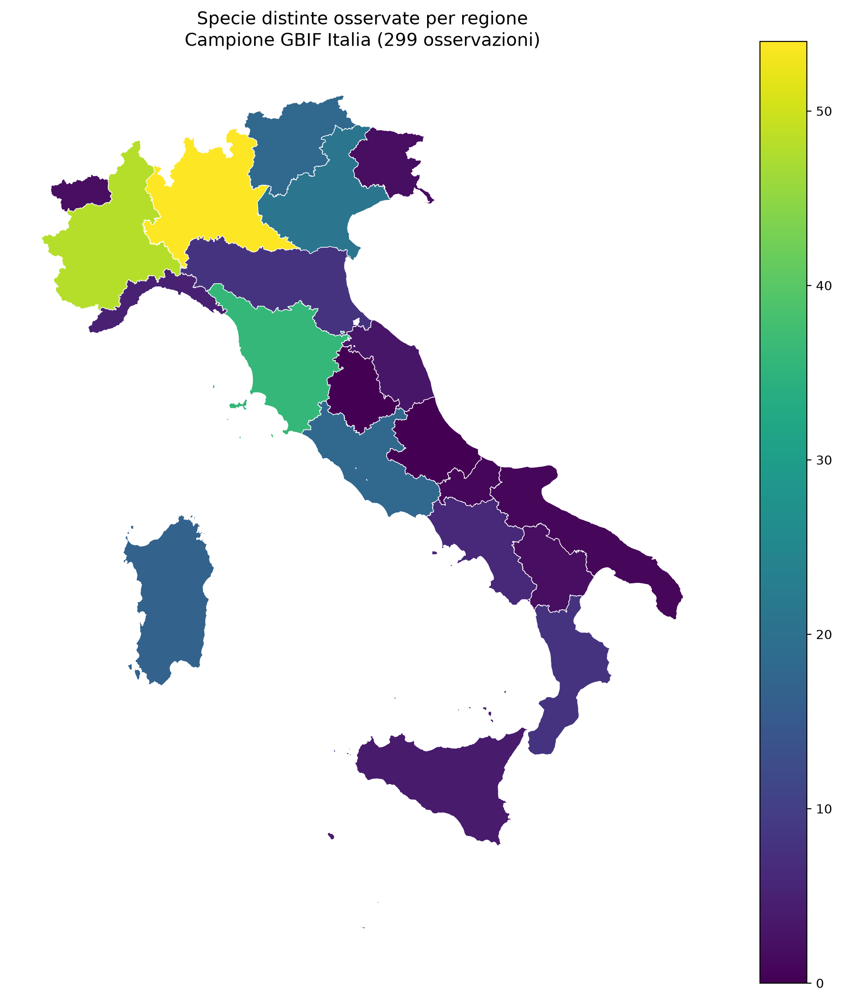

# Italy Biodiversity — GBIF & PostGIS

## Overview

A reproducible geospatial data science project exploring species observations across Italian regions using Python, PostgreSQL, PostGIS and GeoPandas.

The analysis uses a small sample of GBIF occurrence records and calculates the number of distinct species observed within each Italian region.

## Data sources

- **GBIF:** occurrence records retrieved through the GBIF API.
- **geoBoundaries:** administrative boundaries for the 20 Italian regions, retrieved from the Italy ADM2 dataset.

## Technologies

Python, pandas, GeoPandas, Matplotlib, PostgreSQL, PostGIS, Psycopg, SQL and Git.

## Results

- 299 cleaned GBIF occurrence records.
- 183 distinct species identifiers in the full sample.
- 286 observations spatially matched to Italian regions.
- 13 observations not matched to a regional polygon.
- 20 regions included in the final analysis.
- 18 regions with at least one matched observation.

Lombardia has the highest number of distinct species observed in this sample (54), followed by Piemonte (48) and Toscana (36).

## Map

## Reproducibility

1. Create and activate a Python virtual environment.
2. Install dependencies with `pip install -r requirements.txt`.
3. Configure PostgreSQL and enable the PostGIS extension.
4. Copy `.env.example` to `.env` and provide local database credentials.
5. Download GBIF observations and regional boundaries using the scripts in `src/`.
6. Create the database tables using `sql/create_tables.sql`.
7. Load the observations and regional boundaries into PostGIS.
8. Run `python src/create_map.py` to generate the map.

The regional aggregation query is available in `sql/regional_species.sql`.

## Limitations

This project is a technical demonstration, not an estimate of true regional biodiversity.

The GBIF sample is small and non-random. Geographic and taxonomic sampling biases affect the observed species counts. A zero count indicates no observations in this sample, not an absence of species in the region.

Some occurrence coordinates do not intersect the administrative polygons. These records remain in the database but are excluded from the regional aggregation.

## Data attribution

Occurrence data: GBIF.

Administrative boundaries: geoBoundaries. Consult the source dataset's attribution and license terms when redistributing or using the boundaries.